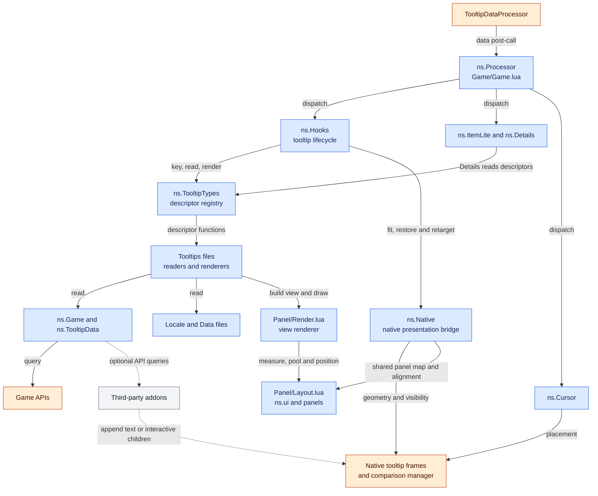
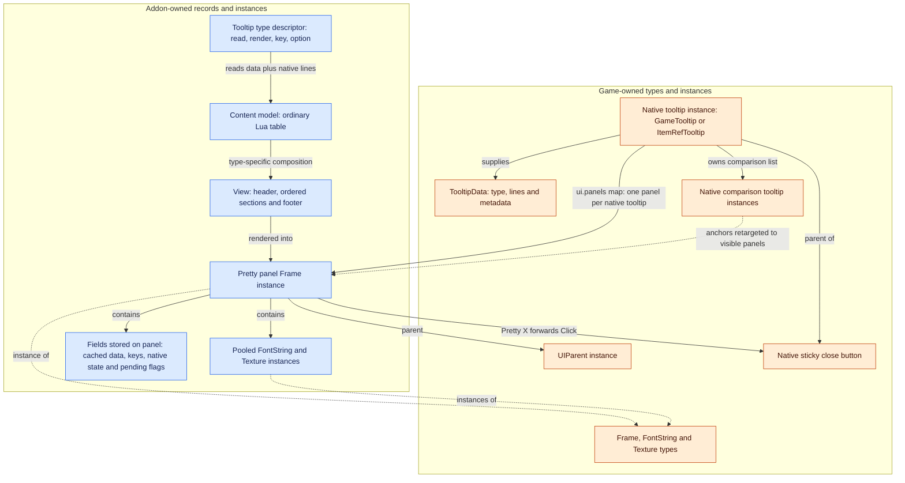
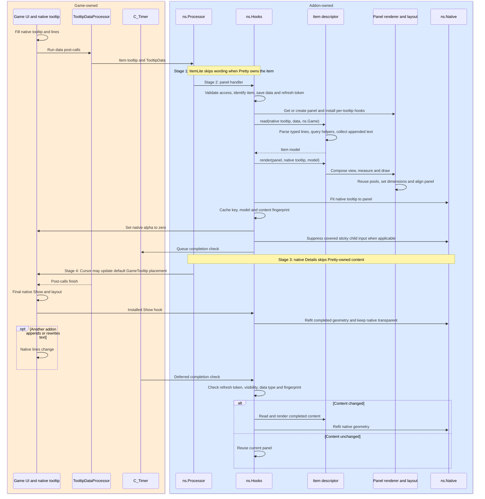
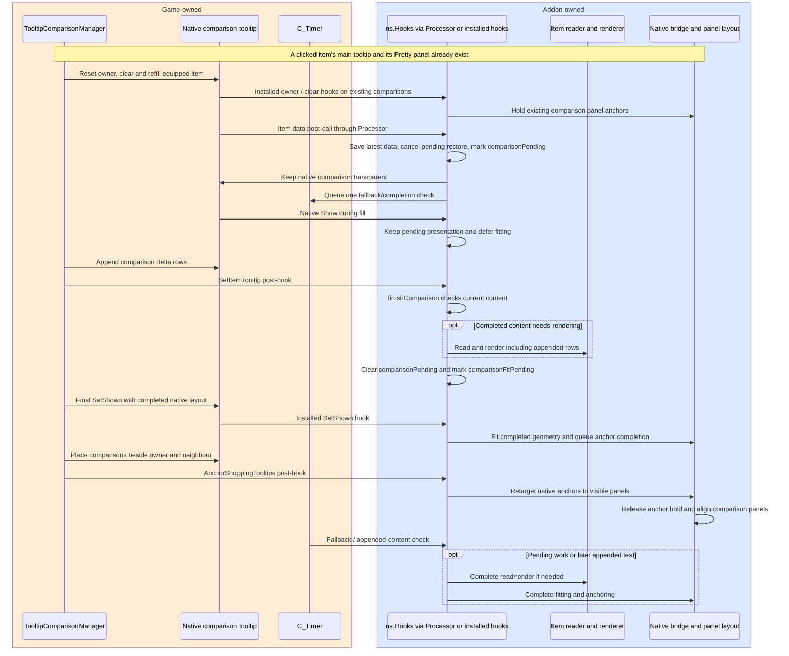

# PrettyTooltip: current architecture

This document describes the implementation at `cc62668` (`Fix comparisons with sticky tooltips`), inspected on 2026-10-21. The diagrams describe current code, including its exceptions and timing dependencies. They do not describe a proposed Retail extension framework.

This sample branch also contains [provisional item extension stubs](examples/README.md)
and an unloaded example. Those additions illustrate candidate callback boundaries;
the diagrams below remain the baseline, rather than a specification of a finished
Retail extension API.

The purpose is to establish a factual baseline before choosing the boundary between the maintained core and independently maintained Retail extensions. The core maintainer does not play Retail. That boundary will need contracts that can be tested outside the game, with Retail behavior and in-game validation owned by Retail contributors.

## Reading the diagrams

Mermaid keeps the diagrams editable beside the source and renderable in Markdown viewers that support it. Blue means addon-owned code or objects, orange means game-owned systems or types, and grey means third-party addons. Sequence diagrams use the same colors for participant groups. Ownership is also written into the group labels.

Lua files share the private `ns` table passed through `...`. Most named components below are tables, functions, or records, rather than classes. A Pretty panel is an addon-owned instance of the game's `Frame` type. An item model and a view are ordinary Lua tables.

Arrows describe calls, registration, data flow, or ownership as labelled; they do not all represent inheritance or file imports.

## 1. Module relationships

The diagram focuses on runtime presentation. Startup is described in section 3; settings, editor, and diagnostics have these additional relationships:

| Module | Relationship to the diagram |
| --- | --- |
| `Core/Settings.lua` | Supplies options/styles to readers, renderers, layout, and integration policies |
| `UI/Options.lua`, `UI/Editor.lua`, `UI/Samples.lua` | Edit settings; previews call descriptor renderers with sample or scanned models |
| `UI/Capture.lua`, `UI/Debug.lua`, `UI/Report.lua` | Capture native data, observe lifecycle calls, and report diagnostics; capture is omitted from release packages |

Several responsibilities share files today:

- [Game/Game.lua](Game/Game.lua) contains both the `ns.Game` API facade and `ns.Processor`. The processor orders the stages `wording -> panel -> details -> cursor`, isolates each handler with `pcall`, and registers one game post-call per data type. Ordering between handlers in the same stage is not specified by its rank-only sort.
- [Panel/Layout.lua](Panel/Layout.lua) contains frame creation, drawing primitives, geometry, profiling helpers, and the tooltip descriptor registry. Most tooltip modules use `ui.defineTooltipType`; Item writes its descriptor directly into `ns.TooltipTypes`.
- [Tooltips/Item.lua](Tooltips/Item.lua) contains its reader, model construction, view composition, custom measurement/drawing, editor helpers, and native-detail generation. Spell, Unit, and the other tooltip modules similarly own their content-specific behavior.
- [Core/Settings.lua](Core/Settings.lua) supplies defaults, style elements, modifier behavior, and a separate `ns.TOOLTIP_TYPES` list for UI/cursor configuration. That list and the runtime `ns.TooltipTypes` descriptor registry are distinct structures.
- The game facade is a useful testing seam, but modules also access game globals and frame methods directly. It is not a complete client isolation boundary.

Optional integrations include Auctionator price queries, Questie wording and line-filled quest tooltips, DialogueUI/EllesmereUI appearance choices, and LibSharedMedia fonts. Other addons can append lines or children without an explicit PrettyTooltip integration.

## 2. Runtime objects and ownership

The visible Pretty panel supplements a live native tooltip. The native frame is normally kept shown with alpha zero; its geometry still participates in game layout, hover behavior, clamping, and comparisons.

The comparison list exists on comparison-capable owners; the close-button relationship applies to sticky item-link tooltips. Each comparison native frame can also have its own Pretty panel through the same map.

Important details:

- `ui.getPanel(tooltip)` creates a panel lazily, parents it to `UIParent`, and stores it in `ui.panels[tooltip]`. Editor previews use panels parented to their preview anchors instead.
- There is no separate session/controller object. [Integration/Hooks.lua](Integration/Hooks.lua) and [Integration/Native.lua](Integration/Native.lua) share state through fields on the panel: `dataType`, `data`, `key`, `fingerprint`, cached item model, saved native alpha/padding, refresh tokens, comparison flags, and parked-frame state.
- Native dimensions are fitted to the panel through padding and related layout work. Comparison native anchors are retargeted to visible panels; comparison panels follow the completed layout's owner/neighbour independently so native anchor resets do not remove their positions.
- The sticky native tooltip remains mouse-enabled. `Native.suppressChildMouse` disables modifiable direct children of `ItemRefTooltip` while covered, except its native close button. Saved mouse states are restored when native presentation resumes. The Pretty X forwards to the enabled native button.
- Native `TooltipData` is treated as input. Pretty readers build their own models. ItemLite changes rendered native FontStrings rather than rewriting the game's data table.

## 3. Loading and registration

[PrettyTooltip.toc](PrettyTooltip.toc) selects files and their order. It currently has one Forever-oriented manifest and no `LoadOnDemand` declaration.

1. Core utilities/settings and locale files load, followed by game helpers, data, panel code, tooltip implementations, UI, and integrations.
2. Files execute as they load: tooltip descriptors are registered; some frames and hooks are created at file scope. The editor is constructed during file loading, even while hidden. Startup is therefore broader than `ns.start()` alone.
3. [PrettyTooltip.lua](PrettyTooltip.lua) receives its own `ADDON_LOADED` and calls the idempotent `ns.start()`: migrate options, register ItemLite, install Hooks, register Details and Cursor, then options and commands.
4. Hooks and Details enumerate the descriptor registry during their installation. There is no automatic subscription mechanism for a descriptor registered afterward. Cursor uses the separate configuration list.
5. Some game UI becomes available later. Comparison-manager hook installation retries on data handover; FlightPath waits for its game UI if needed. These are targeted late-loading accommodations, not a general extension loader.

## 4. Typical item tooltip sequence

This is the successful first presentation of an ordinary item, with Pretty item panels enabled and no original-tooltip modifier. The game-side fill and final Show are represented at the granularity the addon depends on; other game paths can re-enter or repeat these operations.

[Hooks.update](Integration/Hooks.lua) protects descriptor reading and rendering with `pcall`. Missing/unreadable models, invalid keys, or render failures take the native restoration path where the frame can be modified. Core utility guards reject secret values and restricted/forbidden frames before unsafe operations.

Later handovers for the same item generally retain the complete visible panel until the deferred completion check. While shown, the panel also checks native line count/content every 0.25 seconds and queues an update when it detects a change. Fingerprints include settings version, detail-key state, comparison status, native text/colors, and sell-price data; they do not describe arbitrary native child widgets.

The processor's stages are always ordered, but their work depends on presentation settings:

| Presentation | ItemLite | Hooks | Details | Cursor |
| --- | --- | --- | --- | --- |
| Pretty panel | Skips native wording | Reads/renders and covers native frame | Skips native detail block | May follow cursor for eligible GameTooltip |
| Native layout / restyle disabled | Applies optional abbreviated wording | Existing panel becomes idle/restored | Adds a separate block while details modifier is held | May follow cursor |
| Original modifier | Restores original native wording | Restores native presentation | Hides added detail block | Existing cursor policy still applies |

Details uses a separate per-tooltip state/block, shared descriptor readers (or `readDetails`), and each type's `details()` function. It reserves native tooltip space and restores it on clear/hide. See [Integration/ItemLite.lua](Integration/ItemLite.lua), [Integration/Details.lua](Integration/Details.lua), and [Integration/Cursor.lua](Integration/Cursor.lua).

## 5. Comparison refresh and sticky tooltips

Comparison data handover is an intermediate point. The comparison manager can append delta rows after the item post-call; the final native Show/SetShown and anchor operations also matter. This diagram describes the manager-batched path when its hooks are available.

The next-frame check also handles fills that bypass the manager's hooked method, including callers holding an older function reference. If manager batching is unavailable, the ordinary data/show/anchor paths remain in use. The exact sequence above is a supported integration path, not an assertion that every game tooltip follows the same call order.

For sticky tooltips, invisible native children can still intercept input even when their parent has alpha zero. The current child-input suppression and close-button exception are part of this lifecycle, not content parsing. Comparison positioning, refresh holds, native fitting, and mouse handling therefore need to be assessed together.

Clear and hide are different transitions: a clear schedules token-guarded restoration for the next frame and can retain the previous panel during refill; a hide immediately hides the panel and defers native cleanup. A replacement data handover advances the token and cancels pending restoration. Native world-tooltip fades have another path: hide the Pretty panel and park the native frame offscreen, then restore its saved placement when reused.

## 6. Content and rendering boundaries that exist today

| Boundary | Current behavior | Consequence for architecture work |
| --- | --- | --- |
| Descriptor record | `read`, `render`, `key`, `option`; optional `readDetails`, `details`, `detailKeys`, `linesOnly`, `alwaysRedraw` | A real integration seam, but it has no versioned extension contract or automatic late registration |
| Reader inputs | Structured game data plus live native lines and `ns.Game` | A captured data table alone does not represent every input |
| Appended text | `TooltipData.appendedRows` copies unclaimed native FontStrings | Preserves readable text; does not reproduce arbitrary frames or their interactions |
| Item model | Fixed lists such as primary/secondary stats, enchants, effects, set items, extras, and footer rows | Shared parsing and presentation depend on the model's shape |
| View | Ordered header, sections, footer; section kinds `rows`, `prose`, `custom` | Existing composition seam for whole sections |
| Item stats section | One custom section measures/draws several internal groups | Extensions inside that section currently require changing its implementation |
| Measurement | Width fitting measures content before drawing; custom sections may supply `measure` | Additional visuals must participate in measurement as well as drawing |
| Borrowed game objects | Unit rendering can reparent the native health bar and return it through `panel.release` / hide handling | Cleanup and restricted-frame handling are part of rendering correctness |
| Nested content | Macro and PetAction can delegate to Item/Spell descriptors; Spell can embed a created item | A content change can affect more than its primary tooltip type |
| Line-only fills | Quest hooks and FlightPath can call `Hooks.renderLines` with synthetic data | Processor post-calls are not the only entry path |
| Previews | Editor samples call descriptor renderers without the live reader path | Changes must also account for sample models and editor rendering |

Sources: [Panel/Render.lua](Panel/Render.lua), [Game/TooltipData.lua](Game/TooltipData.lua), [Tooltips/Item.lua](Tooltips/Item.lua), [Tooltips/Unit.lua](Tooltips/Unit.lua), [Tooltips/Macro.lua](Tooltips/Macro.lua), [Tooltips/PetAction.lua](Tooltips/PetAction.lua), [Tooltips/Spell.lua](Tooltips/Spell.lua), [Tooltips/Quest.lua](Tooltips/Quest.lua), and [Tooltips/FlightPath.lua](Tooltips/FlightPath.lua).

## 7. Retail PR: separate from the current implementation

[PR #42](https://github.com/FallenShard/PrettyTooltip/pull/42) was assessed at head `d8536ad94f5a2e8b8bbcbbe4683abb77ba748876`. It is not part of the baseline diagrams above.

Its [Mainline TOC](https://github.com/kayti-wow/PrettyTooltip/blob/d8536ad94f5a2e8b8bbcbbe4683abb77ba748876/PrettyTooltip_Mainline.toc) loads Retail implementations alongside shared files and omits Forever-specific datasets. Its [shared Item implementation](https://github.com/kayti-wow/PrettyTooltip/blob/d8536ad94f5a2e8b8bbcbbe4683abb77ba748876/Tooltips/Item.lua) contains direct Retail calls during parsing, model completion, style selection, measurement, and drawing. Those calls identify actual areas of variation to examine; they are not yet a general extension API. The PR also extends fixtures and tests for both client manifests.

Separate TOC selection and runtime loading on demand are distinct concerns. The PR manifest inspected here lists its Retail files for normal addon loading; it does not declare a runtime load-on-demand module.

## 8. What can be verified without playing Retail

[tests/run.py](tests/run.py) runs Lua 5.1 through Lupa. Captured fixtures replay readers/renderers against a simulated game environment and compare models and serialized layout with expected output. Unit tests cover narrower behaviors; the harness can simulate secret values, restricted frames, events, hooks, timers, and comparison sequences. [tests/check_package.py](tests/check_package.py) checks release contents, Lua syntax, and startup across locales.

These tools can protect observable core behavior and, once specified, extension contracts: registration, ordering, model/view composition, matching measurement/drawing, cache invalidation, cleanup, and fallback. The existing harness uses approximate font metrics and explicitly simulated game behavior. Passing tests does not establish actual Retail combat/taint behavior, visual accuracy, mouse hit testing, or compatibility with future game UI changes.

The maintenance constraint is therefore explicit: the core maintainer can maintain small documented integration points and reproducible automated checks. Retail contributors must own Retail-specific rules, representative captures, and live validation. Safe independent evolution needs a tested compatibility boundary; today's internal tables and functions do not yet provide that guarantee.

Before choosing that boundary, use these diagrams to identify which existing responsibilities must remain stable, which content groups need extensibility, and which lifecycle dependencies extensions would need to respect. Any target architecture should be documented separately so proposed objects and APIs cannot be mistaken for current behavior.
